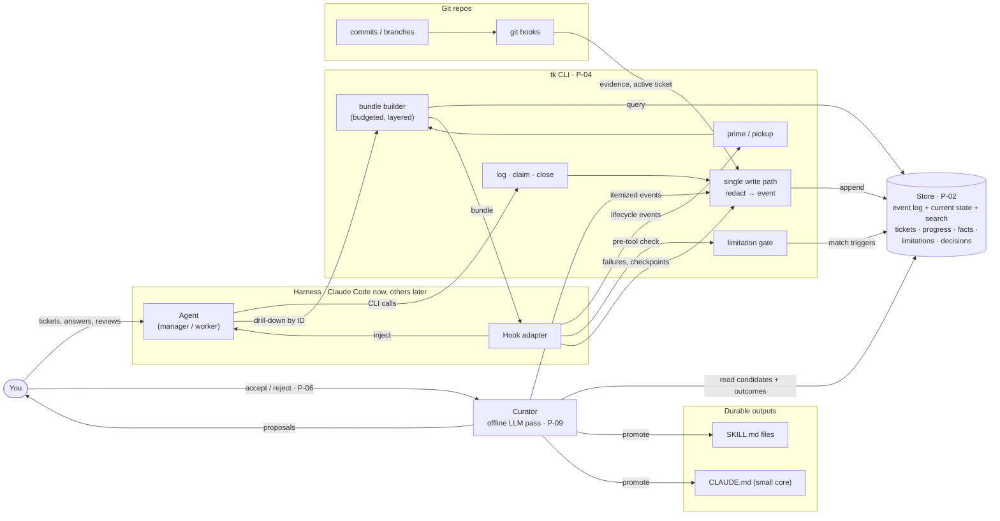
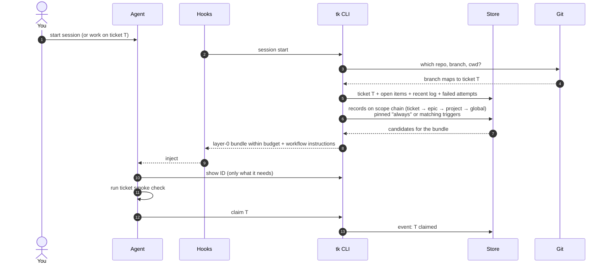
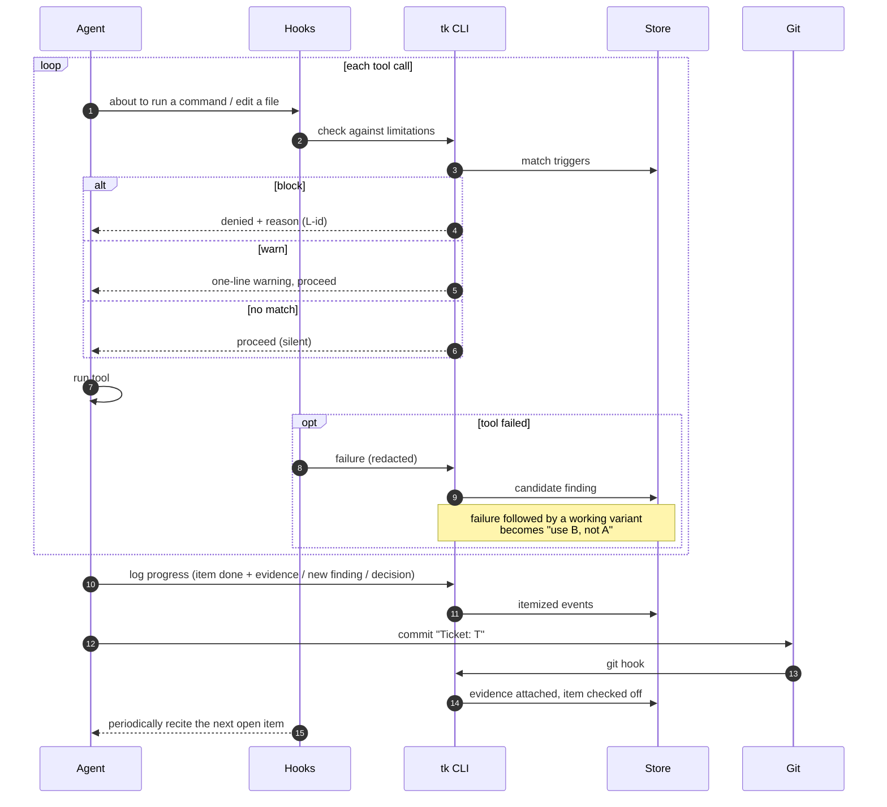
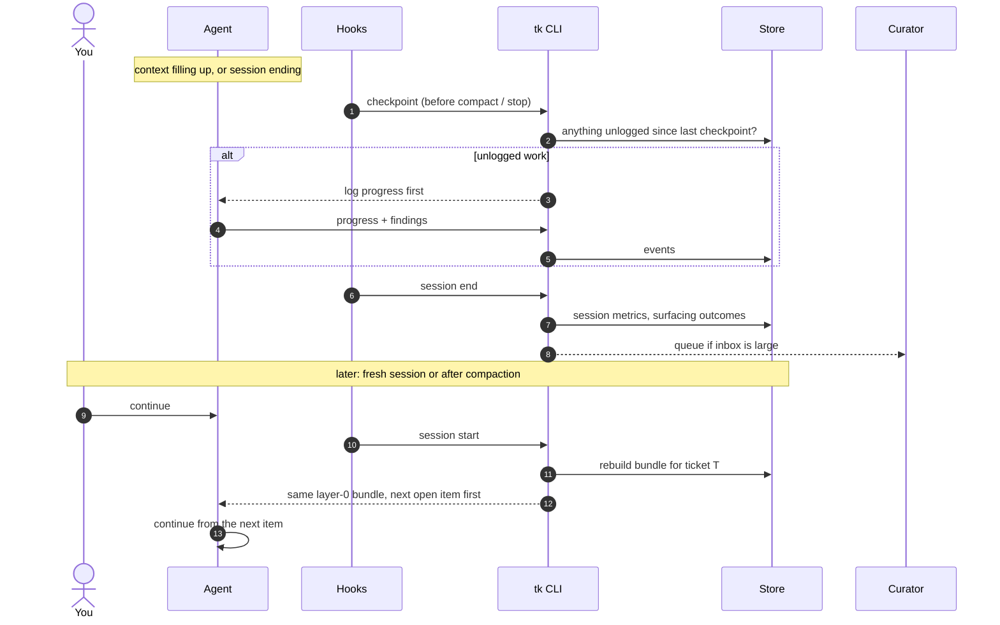
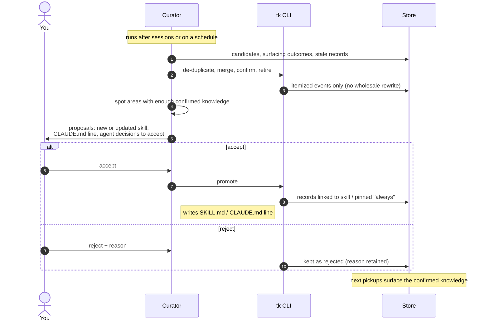
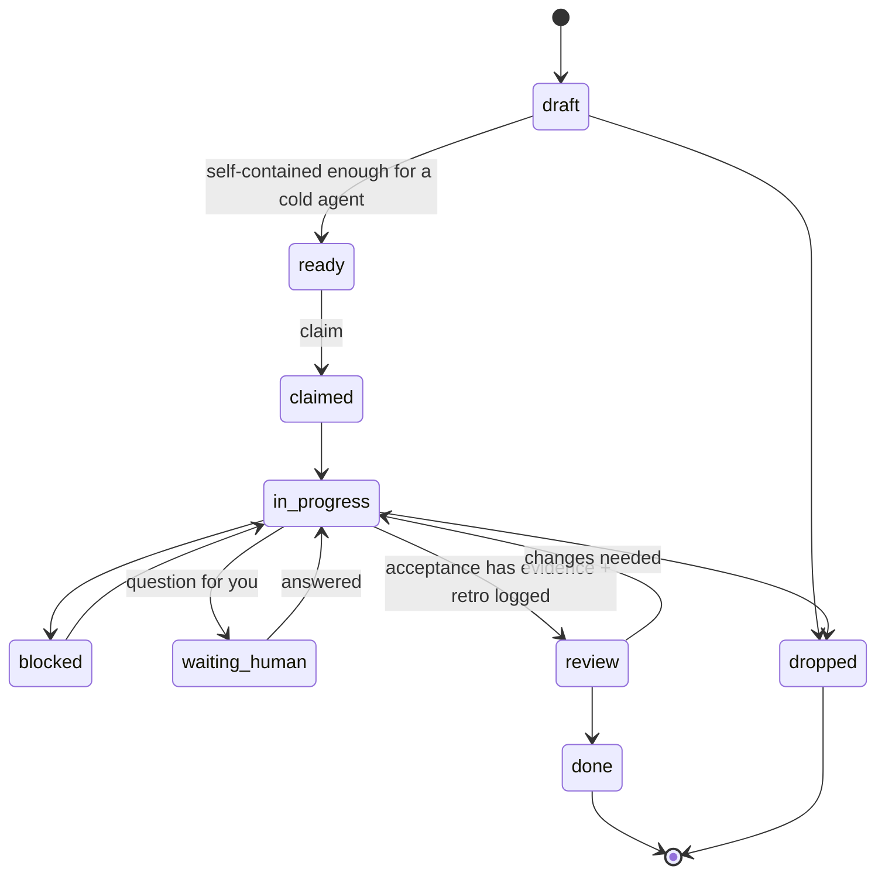
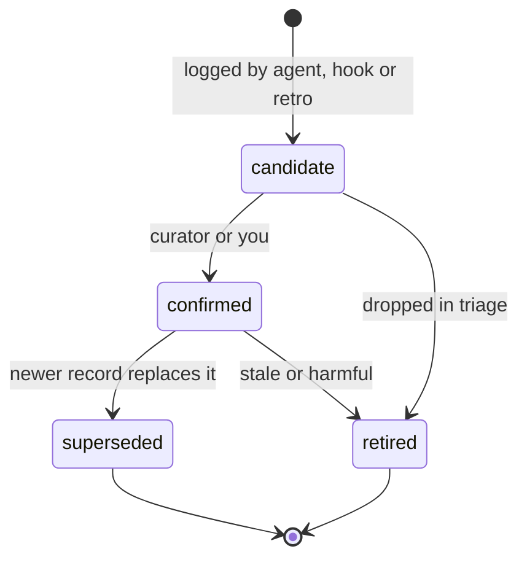
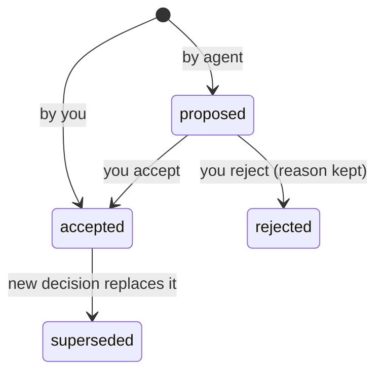

# Architecture

Status: **draft for review** (P-30). Diagrams in Mermaid (D-19). High-level only (D-18): no field lists or threshold values.

Parts that rest on open proposals carry their P-id:
- one store for tickets and knowledge `P-02`
- CLI as the agents' interface `P-04`
- hooks never call an LLM; only the curator does `P-09`
- the user reviews at promotion, not at logging `P-06`
- epic as a scope level `P-08`

Lanes, in the same order in every flow:
**You · Agent · Hooks (harness) · tk CLI · Store · Git · Curator**

---

## 1. System map

---

## 2. Cold start / pickup

---

## 3. Work loop

---

## 4. Checkpoint → resume (instead of compaction)

---

## 5. Curation → promotion

---

## 6. Lifecycle states

### Ticket

### Knowledge record (fact, limitation)

### Decision

---

## 7. Manager / worker dispatch (later)

Not drawn yet. Future use per GOALS.md.
