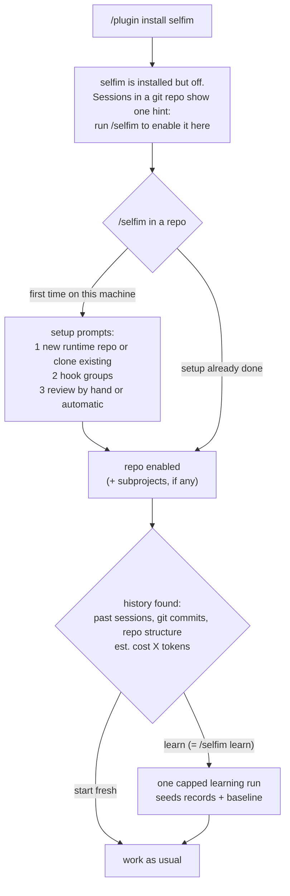
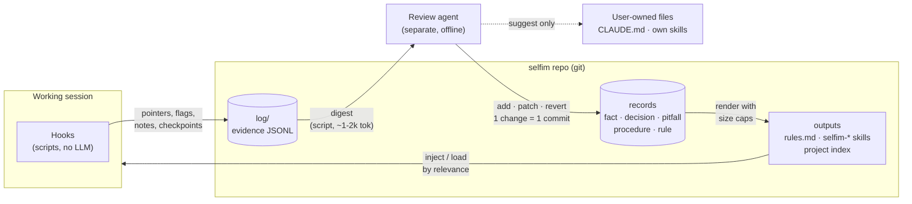
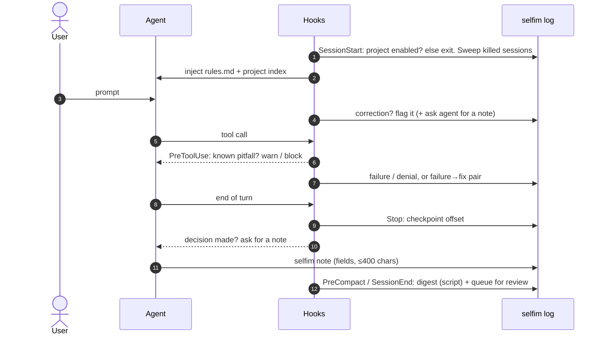
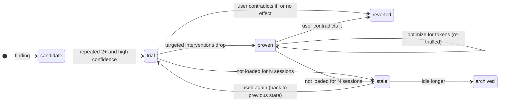
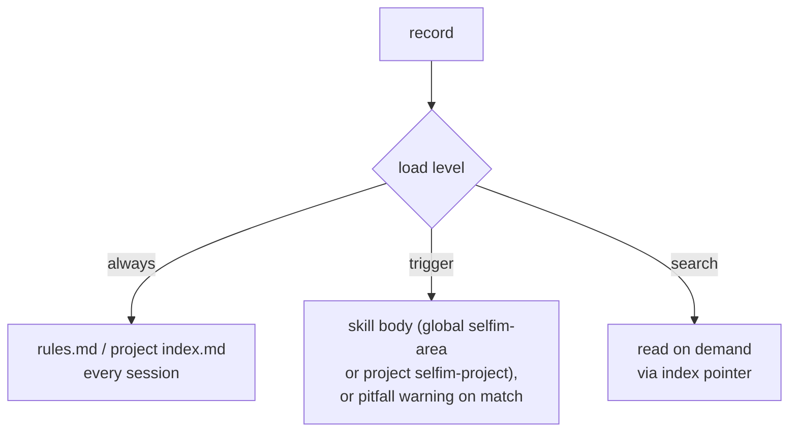

# selfim

A Claude Code plugin (skill + hooks + CLI) that makes agent sessions improve over time. It captures what happens in sessions, turns repeated issues into facts, rules and area skills, measures whether they reduce user interventions at an acceptable token cost, and promotes, demotes or reverts them. Every change is a git commit with what, why and evidence.

> Status: design draft. Full design in [docs/](docs/README.md). Nothing is built yet.

## The problem

- Agents repeat failed commands, re-check confirmed things, re-probe systems that don't change.
- Sessions on the same project never converge on the same facts and workflow.
- Rules pile up in CLAUDE.md, load everywhere, and nobody knows why they changed or whether they help.

**Success metric:** fewer user interventions (corrections, denials, interrupts, re-explanations). **Secondary:** token cost. selfim keeps a ledger of its own total cost (injected context, hooks, notes, review runs) against what it saves.

## Using selfim

### What gets delivered

One Claude Code plugin, installed once per machine:

| Part | What it is |
|---|---|
| hooks | registered machine-wide; do nothing in repos where selfim isn't enabled |
| `/selfim` skill | the user entry point: setup, enable, status, review |
| `selfim` CLI | on PATH while the plugin is enabled; used by the skill, the hooks and the agent (`selfim note`) |

Everything selfim learns lives in a separate git repo (default `~/.selfim`), not in the plugin and not in your projects.

### Install and first run

When a repo is turned on, and later whenever a lot of unprocessed data has built up, `/selfim` asks whether to **learn from history** (past Claude Code sessions, git commits and coding decisions, repo structure, existing memory and CLAUDE.md) or **start fresh**, showing the estimated token cost first. Accepting runs `/selfim learn`, the same command you can run any time. Existing CLAUDE.md, rules and auto memory are treated as already known and never injected again.

Setup also allows `selfim note` (so notes never trigger a permission prompt) and reads Claude Code's transcript retention. Change answers any time with `/selfim settings`.

### Day to day, in an enabled repo

| You'll notice | When |
|---|---|
| nothing extra in the session, at first | until selfim has learned something about this repo or area |
| a short block of rules and a project index at session start | once records exist for the machine or the project (capped at 10k chars) |
| a one-line warning before a command | a known pitfall matches it; proven pitfalls may block instead |
| the agent writing a short `selfim note` | right after you correct it, state a decision, or it fixes a failure |
| `selfim-<area>` and `selfim-project` skills in the skill list | once selfim has distilled knowledge for that area or project |
| a one-line reminder at session start | a lot of unprocessed data has built up: run `/selfim` |

Capture itself is silent: hooks log evidence as you work, and a script digests each session when it ends (killed sessions are picked up at the next start).

### Commands

| Command | Does |
|---|---|
| `/selfim` | the main entry. First time: settings + turn on for this repo. Later: turn on here if off, otherwise show status (queue, trials, cost vs. savings, suggestions) and offer to learn when a lot is unprocessed |
| `/selfim learn` | learn from everything not yet processed: captured sessions and existing history. Shows the estimated cost first when it's large; record changes, one git commit each. On first use, `/selfim` offers exactly this |
| `/selfim settings` | data location, hook groups, when to learn, spending cap per learning run, backlog threshold. Internal tuning lives in the config file |
| `/selfim on` / `/selfim off` | turn selfim on or off for this repo; off keeps the data |
| `/selfim on <dir>` | treat a folder of this repo as its own subproject |
| `selfim note …` | used by the agent when prompted, not by people |

### Reviewing what selfim did

Everything is in the selfim repo's git history: `git -C ~/.selfim log` shows each change with what, why, evidence, expected effect and cost. `/selfim` lists suggestions for your own CLAUDE.md and skills, which selfim never edits itself. If a change was wrong, correct the agent in a session: the record stops loading from the next session and the next review reverts it.

### Uninstall

Remove the plugin. Hooks stop; the selfim repo stays where it is. Remove the `selfim-*` skill links from `~/.claude/skills/` and from enabled projects' `.claude/skills/` to clean up fully.

## How it works

Three rules hold it together:

1. **Hooks are cheap.** Scripts only, pointers instead of copies, successes counted rather than logged. The agent is only asked for a note at moments worth recording.
2. **The LLM only judges.** Scripts digest transcripts and count stats; the review agent decides what to add, patch, promote, demote or revert.
3. **Git is the decision log.** One change per commit (what, why, evidence, expected effect, expected cost). Undo is `git revert`.

## A session, step by step

## What gets tracked

| Layer | Written by | Contents |
|---|---|---|
| **Evidence** (immutable) | hooks, digest script, `selfim note` | interventions, failures + fixes, decisions, tool/skill use per area, git range, token usage, what selfim injected |
| **Records** (curated) | review agent | `fact` (target, stability, last verified) · `decision` (choice, why, revisit-when) · `pitfall` (triggers, what works instead) · `procedure` (what worked) · `rule` (targeted intervention kind) |

Scopes: **machine** (all projects) · **area** (helm, gitops, …; global) · **project** (remote systems, standards; never leaks). Target-bound facts never leave their project.

## Lifecycle

| State | Loaded? | Judged by |
|---|---|---|
| candidate | no | repetition + confidence |
| trial | yes | **interventions** of its targeted kind |
| proven | yes | **token cost** (same effect, fewer tokens) |
| stale / archived | no | reader activity |
| reverted | no | kept to block re-adding the same change |

`pinned` records never move. Only reads (loaded, matched, surfaced) keep a record alive; selfim's own edits don't. Nothing is deleted: a revert is a forward commit that changes state.

## What a session pays

| Skill layer | Holds | Visible in |
|---|---|---|
| global `selfim-<area>` (`~/.claude/skills`) | cross-project know-how | every session |
| project `selfim-project` (`<project>/.claude/skills`, git-excluded) | that project's knowledge | that project only |

A record stays `always` only while its impact pays for that cost; otherwise it drops to `trigger` or `search`. Skills are few and broad (one `selfim-<area>` per area) so their descriptions stay visible.

## Ownership

| selfim changes automatically (traced, revertible) | selfim only suggests |
|---|---|
| `rules.md`, `selfim-*` skills, project index, skill and triggers | your CLAUDE.md, your own skills, your memory folder |

Data lives in one git repo (`~/.selfim` by default): `machines/<host>/`, `areas/<area>/`, `projects/<id>/`. Nothing selfim writes in a project is committed or shows in `git status`, and project data never crosses into other projects.

## Design docs

| | |
|---|---|
| [01-intent](docs/01-intent.md) | why, success metric, goals, anti-goals |
| [02-capture](docs/02-capture.md) | hooks, prompted notes, concision rules, digest, secrets |
| [03-knowledge](docs/03-knowledge.md) | scopes, record kinds and fields, project identity |
| [04-review](docs/04-review.md) | review agent, when something new is added, commits |
| [05-lifecycle](docs/05-lifecycle.md) | stats, states, transitions, impact vs. token cost |
| [06-outputs](docs/06-outputs.md) | ownership, skills, size caps, load levels, pitfall check |
| [07-setup](docs/07-setup.md) | runtime repo layout, setup prompts |
| [08-open](docs/08-open.md) | open design calls to review, builder's choices, prior art |
| [09-stack](docs/09-stack.md) | tooling: plugin, Python stdlib, storage, git trailers, `claude -p` review |
